  

  

  <h1>⚡ CHANDAN PARGI ⚡</h1>
  
<strong>Fullstack Developer &bull; MERN Stack Specialist &bull; Real-Time Systems Builder</strong>

  
<em>Turning ideas into scalable, real-time web applications and high-impact digital experiences.</em>

  
📍 Ahmedabad, India &nbsp;|&nbsp; 💼 Open to Opportunities &amp; Collaborations

  
  
  
  
  
  
  

 

  

 

  

## 👨‍💻 About Me

Hello! I am **Chandan Pargi**, a passionate **Fullstack Developer** and **MERN Stack Engineer** dedicated to building modern, responsive, and resilient web applications.

- 🚀 **Fullstack Engineering**: Hands-on experience architecting full-stack web platforms using **MongoDB**, **Express.js**, **React.js**, **Node.js**, and **Next.js**.
- ⚡ **Backend & Real-Time Mastery**: Developing robust backend APIs and services using **NestJS**, **TypeScript**, **PostgreSQL**, **Prisma ORM**, **Supabase**, and real-time bidirectional communication via **Socket.IO**.
- 🏢 **Production SaaS Experience**: Contributed to AI-driven SaaS solutions including **HelloBooks AI** (AI-powered bookkeeping platform) and **HelloGrowth CRM** at Meru Technosoft, focusing on microservices, API integrations, and SEO-optimized Next.js architectures.
- 🎓 **Education**: Bachelor of Engineering (Information Technology) from **Government Engineering College, Gandhinagar**.
- 💡 **Philosophy**: Clean architecture, fluid user interfaces, performance optimization, and continuous learning.

 

  

## 🛠️ Tech Stack &amp; Skills

### 🌐 Frontend Development

  
  
  
  
  
  
  
  
  

### ⚙️ Backend &amp; APIs

  
  
  
  
  
  

### 🗄️ Databases &amp; ORM

  
  
  
  
  

### 🚀 Cloud, Tools &amp; Services

  
  
  
  
  
  
  
  
  

 

  

## 🌟 Featured Projects

### 🏆 01. Plays Go — Location-Based Sports Matchmaking Platform
> **Timeline**: 2026 – Present &nbsp;|&nbsp; 🌐 [**Live Demo: playsgo.vercel.app**](https://playsgo.vercel.app)

A full-scale real-time sports discovery and matchmaking web platform helping athletes and sports enthusiasts connect, organize games, and play locally.

- **Stack**: `Next.js` &bull; `NestJS` &bull; `TypeScript` &bull; `PostgreSQL` &bull; `Prisma ORM` &bull; `Socket.IO` &bull; `Cloudinary` &bull; `Razorpay`
- **Key Features**:
  - **Radius-Based Geolocation Discovery**: Dynamic geolocation search allowing users to discover nearby venues, games, and active sports players.
  - **Matchmaking &amp; Skill Filtering**: Multi-criteria filtering by sport, skill proficiency, and game availability.
  - **Real-Time Communication**: Live chat room integration powered by **Socket.IO** for instant team messaging and coordination.
  - **Security &amp; Payments**: JWT authentication, Google OAuth integration, secure image handling via Cloudinary, and Razorpay payment integration for venue bookings.

---

### 🏅 02. Alpha Sports Portal — Sports Management System
> **Timeline**: 2024 – 2025 &nbsp;|&nbsp; 🌐 [**Live Demo: alphaschool-theta.vercel.app**](https://alphaschool-theta.vercel.app)

An end-to-end sports administration and tournament management portal for academic institutions and sports organizations.

- **Stack**: `MongoDB` &bull; `Express.js` &bull; `React.js` &bull; `Node.js` &bull; `Cloudinary` &bull; `JWT`
- **Key Features**:
  - **Student &amp; Athlete Management**: Comprehensive registration pipelines for student participants, athletic categories, and sports tournaments.
  - **Admin Approval Dashboard**: Role-based access control with real-time verification and approval workflows for athletic coordinators.
  - **Media &amp; Roster Management**: Avatar and identity card image uploads using Multer and Cloudinary, with dynamic roster capacity management APIs.

---

### 🤖 03. HelloBooks AI &amp; HelloGrowth CRM (Enterprise SaaS Contributions)
> **Organization**: Meru Technosoft &nbsp;|&nbsp; **Role**: Fullstack Developer Intern

Contributed to production-grade SaaS products powering enterprise workflow automation and bookkeeping.

- **Stack**: `React.js` &bull; `Node.js` &bull; `PostgreSQL` &bull; `Prisma ORM` &bull; `Supabase` &bull; `Next.js`
- **Key Highlights**:
  - Developed and maintained critical bookkeeping features for **HelloBooks AI** using React.js, Node.js, and Prisma ORM.
  - Built customer relationship management workflows for **HelloGrowth CRM** integrated with Supabase.
  - Enhanced Next.js frontend performance, API route efficiency, and SEO rankings across client portals.

 

  

## 💼 Experience &amp; 🎓 Education

| Role | Organization / Institution | Duration | Location |
| :--- | :--- | :--- | :--- |
| **Fullstack Developer Intern** | Meru Technosoft | 10/2025 – 09/2026 | Ahmedabad, India |
| **Fullstack Developer Trainee** | Felix IT Systems | 03/2025 – 08/2025 | Ahmedabad, India |
| **B.E. Information Technology** | Government Engineering College, Gandhinagar | Completed 05/2022 | Gandhinagar, India |

 

  

## 📊 GitHub Analytics &amp; Activity

  <table border="0">
    <tr>
      <td align="center" width="50%">
        
      </td>
      <td align="center" width="50%">
        
      </td>
    </tr>
  </table>

   

  

 

  

## 💬 Get In Touch

Whether you want to discuss a potential collaboration, discuss fullstack architecture, or explore new opportunities, my inbox is always open!

  
  &nbsp;&nbsp;
  

 

  

  <code>rxn@developer:~$ echo "Always learning, building, and shipping."</code>
  
Crafted with passion &bull; Designed in Black &amp; Yellow &bull; © 2026 Chandan Pargi

